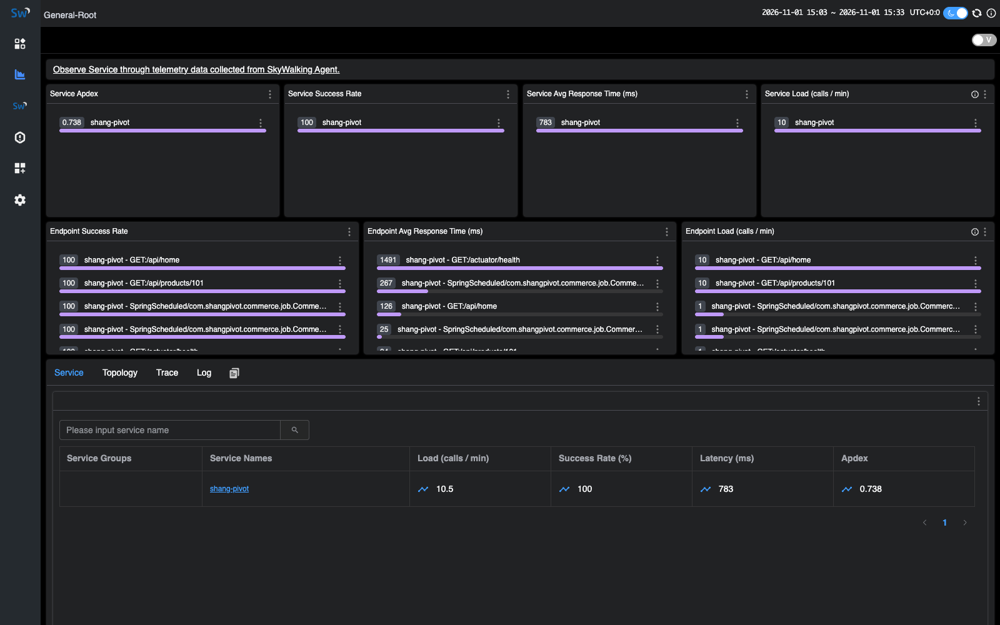
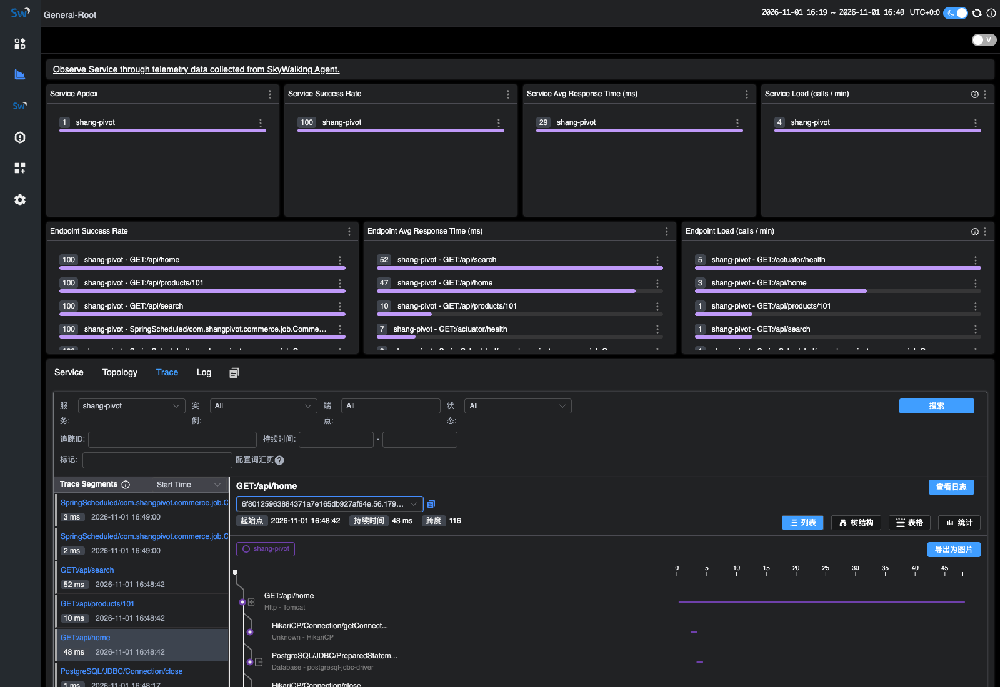

# SkyWalking 全链路监控课件（尚品汇电商）

> 目标：从“会看监控”到“能定位一次慢请求”，再到“能设计一套可运维的监控体系”。  
> 运行环境：腾讯云 4C8G，SkyWalking OAP/UI 10.2.0，Java Agent 9.5.0，Spring Boot 4.1.1 / Spring 7。  
> 配套手册：[SkyWalking 运维手册](../docs/SkyWalking运维手册.md)  
> 部署实录：[tencent-ops-stack.md](../docs/tencent-ops-stack.md)



---

## 0. 学习目标

学完本课，应该能回答：

1. Trace、Span、Segment、Endpoint、Instance 分别是什么？
2. SkyWalking 的数据是怎么从 Java 应用进到 PostgreSQL，再到 UI 的？
3. 一个接口变慢，按什么顺序查？先看服务、实例、端点，还是先看 SQL？
4. 如何从 Trace 里找到慢 SQL、连接池等待、Redis 调用？
5. 告警规则怎么写？Webhook 怎么接？为什么告警没有触发？
6. 当前这套监控还缺什么？为什么缺？下一步怎么补？

---

## 1. APM 基础：先建立共同语言

### 1.1 Trace / Span / Segment

- **Trace**：一次完整请求的调用链，有全局 `traceId`。
- **Span**：调用链中的一个动作，例如一次 HTTP 请求、一次 SQL、一次 Redis 调用。
- **Segment**：SkyWalking 里同一服务实例内的一组 Span，通常对应一次请求在单个进程内的执行。
- **Entry Span**：服务入口，例如 Tomcat 收到 `GET /api/home`。
- **Local Span**：进程内方法/连接池，例如 `HikariCP/Connection/getConnection`。
- **Exit Span**：出站调用，例如 JDBC、Redis、HTTP Client。

一次 `/api/home` 的典型树：

```text
Tomcat GET:/api/home                 Entry
├─ HikariCP/Connection/getConnection Local
├─ PostgreSQL/JDBC/.../execute       Exit   SELECT ... home_slot
├─ HikariCP/Connection/getConnection Local
├─ PostgreSQL/JDBC/.../execute       Exit   SELECT ... spu
├─ ...
└─ HikariCP/Connection/close         Local
```

### 1.2 四个黄金指标

| 指标 | 问题 | SkyWalking 对应 |
|---|---|---|
| Latency | 慢不慢 | `service_resp_time`、`service_percentile` |
| Traffic | 流量多少 | `service_cpm` |
| Errors | 错多少 | `service_sla`、Trace `isError` |
| Saturation | 资源满没满 | JVM CPU/Heap/GC、连接池、DB/Redis |

> 排障顺序建议：**Errors → Latency → Saturation → Traffic**。先确认“是不是错”，再确认“哪里慢”，最后看“资源是否打满”。

### 1.3 RED 与 USE

- **RED**：Rate、Errors、Duration，适合服务/接口。
- **USE**：Utilization、Saturation、Errors，适合主机/数据库/队列。

SkyWalking 强在 RED + Trace；主机/数据库/队列的 USE 需要额外 exporter，见第 11 节。

---

## 2. SkyWalking 架构

```text
Java 应用
  └─ SkyWalking Java Agent（字节码增强）
       └─ gRPC :11800
            └─ OAP（分析、聚合、告警）
                 ├─ PostgreSQL（trace/metrics/alarm）
                 ├─ GraphQL :12800
                 └─ Webhook → 告警接收器
                      └─ UI :60086
```

### 2.1 为什么选 SkyWalking

对比常见开源方案：

| 方案 | 强项 | 不足 |
|---|---|---|
| SkyWalking | Java Agent 零代码、服务/实例/端点指标、拓扑、告警、UI 完整 | 日志/主机指标弱，UI 子路径要处理 |
| Jaeger | CNCF、Trace 查询简单 | 指标/告警/拓扑要另配 |
| Grafana Tempo | 与 Grafana/Loki 生态好、成本低 | 需要 Prometheus/Grafana 组合 |
| Zipkin | 轻量、协议简单 | 分析和告警能力弱 |
| OpenTelemetry |  instrumentation 标准、厂商中立 | 本身不是后端，需要 Collector + 后端 |

本项目的选择：

- 用 **SkyWalking Java Agent** 快速接入，拿到接口/SQL/JVM；
- 用 **SkyWalking OAP** 做聚合、拓扑、告警；
- 后续用 **OpenTelemetry** 统一 instrumentation，把 Trace 同时送到 SkyWalking/Tempo；
- 用 **Prometheus + Grafana** 补主机/数据库/Redis/Nginx 指标。

### 2.2 当前部署拓扑

```text
公网 :60084
└─ Nginx
   ├─ /             商城
   ├─ /zentao/      禅道 60082
   └─ /skywalking/  SkyWalking UI 60086
                       └─ /graphql → OAP 12800

shang-pivot (8086)
  └─ Java Agent 9.5.0 → OAP 11800 → PostgreSQL skywalking
```

---

## 3. Agent 接入：为什么是 9.5.0

项目是 Spring Boot 4.1.1 / Spring Framework 7.0.9。

- Java Agent 9.3.0：Spring MVC 插件只到 5.x，启动日志出现大量 `is not activated`，HTTP 链路不完整。
- Java Agent 9.5.0：HTTP、JDBC、HikariCP、Redis、定时任务均能生成 Span。

接入方式：

```ini
[Service]
Environment="SW_AGENT_NAME=shang-pivot"
Environment="SW_AGENT_INSTANCE_NAME=shang-pivot-prod"
Environment="SW_AGENT_COLLECTOR_BACKEND_SERVICES=127.0.0.1:11800"
ExecStart=
ExecStart=/usr/bin/java -javaagent:/opt/skywalking/agent-95/skywalking-agent.jar -jar /opt/shang-pivot/current/app.jar
```

验证：

```bash
curl -s http://127.0.0.1:8087/actuator/health
python3 /opt/skywalking/skywalking-query.py --service shang-pivot --minutes 10
```

> 关键点：Agent 版本要跟框架版本匹配。不要只看“服务注册成功”，还要看“有没有 Entry Span”。

---

## 4. UI 导览与指标

### 4.1 服务总览

路径：

```text
SkyWalking → General-Service → Services → shang-pivot
```

看四个卡片：

- Apdex：满意度，低于 0.9 要关注；
- Success Rate：成功率；
- Avg Response Time：平均耗时；
- Load：每分钟调用数。

再看 Endpoint 的 TopN：Success Rate、Avg Response Time、Load。

### 4.2 实例

```text
shang-pivot → Instance → shang-pivot-prod
```

看 JVM CPU、Heap、Thread、Old GC。当前实测：

| 指标 | 值 |
|---|---:|
| JVM CPU | 1% |
| Heap | ~212 MB |
| Live Threads | 67 |
| Old GC Count | 0 |

### 4.3 Trace

```text
Trace 页签 → 选择服务/端点/耗时/错误 → 点击一条 Trace
```



读法：

1. 最上方是 Entry Span，确认总耗时和 HTTP 状态；
2. 中间是 Local/Exit Span，找耗时最长的；
3. 点 SQL Span，看 `db.statement`、`peer`、`component`；
4. 看 Span 数量，100+ 通常意味着 N+1 或重复查询。

---

## 5. 排查方法论：从告警到 SQL

### 5.1 五步法

```text
1. 告警/反馈：确定服务、时间窗、影响面
2. 服务 RED：成功率、平均耗时、P95、QPS
3. 实例/JVM：单实例？GC？CPU？线程？
4. 端点 TopN：哪个接口贡献最大
5. Trace/Span：Tomcat → HikariCP → JDBC/Redis → SQL
```

### 5.2 第一步：确认问题类型

| 现象 | 优先指标 |
|---|---|
| 5xx/业务失败 | `service_sla`、`endpoint_sla`、错误 Trace |
| 平均耗时上升 | `service_resp_time`、P95/P99 |
| 只有某接口慢 | `endpoint_resp_time` TopN |
| 只有某实例慢 | `service_instance_resp_time`、JVM |
| 数据库慢 | `database_access_resp_time`、SQL Span |
| 流量突增 | `service_cpm`、Nginx 日志 |

### 5.3 第二步：服务级

先看“是不是全局问题”：

- 所有端点都慢 → 基础设施/数据库/GC/网络；
- 只有部分端点慢 → 业务代码/SQL/下游；
- 成功率下降但耗时正常 → 异常/超时/限流/下游错误。

### 5.4 第三步：实例级

如果服务有多个实例，先看是不是单实例：

- 单实例 CPU 高 → 该实例负载/线程/GC；
- 所有实例都高 → 流量/下游/数据库；
- Old GC 频繁 → 内存压力，先看 Heap/对象分配；
- 线程数持续上升 → 阻塞/连接池/死锁。

### 5.5 第四步：端点级

选“耗时 × 流量”最大的端点，而不是只选最慢的端点。  
例如 `/actuator/health` 偶尔 1.5s，但流量很低；`/api/home` 58ms 但每次 100+ Span，优化收益更大。

### 5.6 第五步：Trace/Span

按顺序看：

1. **Entry**：总耗时、HTTP 状态；
2. **HikariCP/getConnection**：是否在等连接；
3. **JDBC execute**：SQL 本身耗时；
4. **Lettuce**：Redis 是否慢；
5. **Span 数量**：是否 N+1。

判断：

| 现象 | 结论 |
|---|---|
| `getConnection` 慢，SQL 快 | 连接池不足/数据库连接数满 |
| SQL 慢，`getConnection` 快 | SQL/索引/数据量问题 |
| SQL 快，Entry 慢 | 应用内计算/序列化/多次查询 |
| Redis Span 慢 | 缓存/网络/大 key |
| 只有错误 Trace，耗时正常 | 异常/下游 4xx/5xx |

### 5.7 第六步：SQL 确认

看 Span 标签：

- `db.statement`：SQL 文本；
- `peer`：数据库地址；
- `component`：`postgresql-jdbc-driver`；
- 是否超过 `SW_SLOW_DB_THRESHOLD`（当前 200ms）。

如果 SQL 里出现大量 `IN (?,?,?,...)` 或同一 SQL 重复几十次，优先怀疑 N+1。

### 5.8 第七步：日志与业务确认

当前还没有 TraceId → 日志的集中关联，先用：

```bash
journalctl -u shang-pivot --since '10 min ago' --no-pager
```

看异常堆栈、业务错误码。后续在 Logback 输出 `traceId`，接 Loki/ELK/OTel Logs。

---

## 5.9 实战记录：从公网请求到 SQL

这一节是一次真实演练，时间：**2026-11-01 16:48:42 CST**。

### 第一步：从公网入口发请求

```bash
BASE=http://49.233.135.247:60084

curl -sS -m 10 -w '\nHTTP %{http_code} time=%{time_total}s\n' \
  "$BASE/api/home" -o /tmp/home.json
```

也可以直接运行演练脚本（仓库 `scripts/observability/demo-request.sh`，服务器 `/opt/skywalking/demo-request.sh`）：

```bash
BASE_URL=http://49.233.135.247:60084 bash scripts/observability/demo-request.sh
```

结果：

```text
HTTP 200 time=0.077574s
```

响应摘要：

```json
{
  "code": 0,
  "msg": "success",
  "traceId": "899bc6269ffd468eab46ee506c56b6b1",
  "feed": 20,
  "slots": 6
}
```

同时请求了另外两个接口：

| 接口 | HTTP | 客户端耗时 | 响应摘要 |
|---|---:|---:|---|
| `/api/home` | 200 | 77.6ms | `feed=20, slots=6` |
| `/api/products/101` | 200 | 36.6ms | `skuCount=3` |
| `/api/search?q=iPhone` | 200 | 80.1ms | `total=2` |

> 注意：响应里的 `traceId` 是**业务链路 ID**，不是 SkyWalking 的 Trace ID。两者不要混用，按时间窗 + 端点关联。

### 第二步：在 SkyWalking 找到 Trace

等待约 10–15 秒，让 Agent 上报、OAP 聚合：

```bash
python3 /opt/skywalking/skywalking-query.py \
  --service shang-pivot --minutes 5 --limit 100 --endpoint /api/home
```

结果：

```text
1793522922191   48ms   GET:/api/home
trace=6f80125963884371a7e165db927af64e.56.17935229221910007 spans=116
SQL spans: 39
```

关键对比：

| 指标 | 值 |
|---|---:|
| 客户端总耗时（含 Nginx/网络） | 77.6ms |
| 应用内 Trace 耗时 | 48ms |
| Span 总数 | 116 |
| SQL Span 数 | 39 |

结论：**服务端 48ms，客户端 77.6ms，约 29.6ms 消耗在 Nginx、网络、响应传输/序列化上**。只看客户端耗时会误判成“应用慢”，只看 Trace 会漏掉接入层成本。

### 第三步：看 Span 树

```text
Entry  Tomcat GET:/api/home
Local  HikariCP/Connection/getConnection
Exit   PostgreSQL/JDBC/.../executeWithFlags
       SELECT ... FROM commerce.site_brand WHERE id=?
Local  HikariCP/Connection/close
...
```

一次 `/api/home` 的结构：

- 1 个 HTTP Entry；
- 39 个 SQL Exit；
- 大量 HikariCP getConnection/close；
- 总 Span 116。

### 第四步：看 SQL 分类

39 条 SQL 主要分为：

1. `commerce.site_brand`：品牌信息；
2. `commerce.home_slot`：首页运营位；
3. `commerce.home_slot_item`：运营位商品，多次重复；
4. `commerce.spu`：商品 SPU，批量 + 单条混合；
5. `commerce.sku`：SKU，多次单条/批量查询；
6. `identity.system_config`：系统配置；
7. `COUNT(*)`：商品总数。

典型 SQL：

```sql
SELECT id,logo_key,name,slogan,favicon_key,updated_at,updated_by,trace_id
FROM commerce.site_brand WHERE id=?

SELECT id,slot_id,sort,spu_id,image_key,link_type,link_value,title,extra,status
FROM commerce.home_slot_item
WHERE (slot_id = ? AND status = ?) ORDER BY sort ASC

SELECT id,spu_id,title,price,cost_price,bar_code,specs,pic,status,created_at,updated_at,deleted,trace_id
FROM commerce.sku
WHERE deleted=false AND (spu_id = ? AND status = ?)
```

### 第五步：判断问题

这条 Trace 没有报错、没有慢 SQL（48ms 总耗时），但有两个明显优化点：

1. **重复查询**：`home_slot_item`、`sku` 在同一请求内多次执行相似 SQL；
2. **N+1 风险**：20 个 feed 商品触发多条 SKU 查询，商品数增加时会线性放大。

建议：

- 首页品牌/运营位/系统配置加本地缓存；
- 按 `spu_id` 批量查 SKU，而不是逐个查；
- 限制首页 feed 数量；
- 对 `home_slot_item(slot_id,status)`、`sku(spu_id,status)` 建索引；
- 用 P95 和 SQL Span 数作为优化验收指标。

### 第六步：课堂提问

1. 为什么客户端 77.6ms，Trace 只有 48ms？
2. 39 条 SQL 里，哪些是重复查询？哪些可以合并？
3. 如果 feed 从 20 增加到 100，Span 数和 SQL 数会怎么变？
4. 如果 `HikariCP/getConnection` 占比变高，应该先查什么？
5. 业务 `traceId` 和 SkyWalking Trace ID 有什么区别？

> 经验：**先对比客户端耗时与服务端 Trace，再决定是查应用、查接入层，还是查网络。** 不要看到“接口慢”就直接改 SQL。


---

## 6. 实战案例

### 6.1 案例一：首页 `/api/home` 慢

现象：P95 升高，平均耗时 58ms，但一次请求 116 个 Span。

排查：

1. 服务 RED：成功率 100%，平均 58ms，P95 可能更高；
2. 端点：`GET:/api/home` 流量最高；
3. Trace：116 Span，绝大多数是 `SELECT ... FROM commerce.spu/sku/home_slot_item`；
4. 结论：首页聚合存在多次单表查询/N+1；
5. 优化：合并查询、批量查询、缓存首页运营位、限制 SKU 数量；
6. 验证：P95 下降、Span 数下降、DB QPS 下降。

### 6.2 案例二：登录慢

现象：`POST:/api/auth/login` 偶发 945ms。

排查：

1. 看 Trace 是否有短信/风控/DB 慢；
2. 看 `HikariCP/getConnection` 是否等待；
3. 看数据库连接数、CPU；
4. 看是否有同步短信/外部 HTTP 调用；
5. 结论：如果是外部依赖，加超时/重试/异步；如果是 DB，加索引/缓存。

### 6.3 案例三：数据库连接池耗尽

现象：接口整体变慢，`getConnection` Span 很长，SQL 很快。

排查：

1. `HikariCP/getConnection` 耗时占比；
2. PostgreSQL `pg_stat_activity` 连接数；
3. 应用连接池配置（max pool size）；
4. 是否有长事务/连接泄漏；
5. 处理：调池大小、修长事务、加超时、读写分离。

### 6.4 案例四：JVM GC

现象：所有接口周期性变慢，CPU 高。

排查：

1. Instance 页面 Old GC 次数/时间；
2. Heap 使用率；
3. Trace 中是否有大对象/大 SQL 结果；
4. 处理：调堆、查内存泄漏、减少大查询、开启持续剖析。

---

## 7. 慢 SQL 与 SQL 参数

OAP 配置：

```ini
SW_SLOW_DB_THRESHOLD=default:200,mongodb:100
```

- 超过 200ms 标记为慢；
- 单位 ms；
- 修改后需重启 OAP。

Agent SQL 参数：

```ini
SW_JDBC_TRACE_SQL_PARAMETERS=false
```

- 默认关闭；
- 打开后能看到 `?` 的实际值；
- 可能泄露手机号/地址，生产慎用。

课堂练习：在测试环境把阈值改为 50ms，观察慢 SQL 数量变化，再恢复 200ms。

---

## 8. 告警体系

### 8.1 规则

当前已配置 8 条规则：

- 服务响应时间 > 1000ms；
- 服务 SLA < 95%；
- P95 > 1000ms；
- 实例响应时间 > 1000ms；
- 数据库访问 > 200ms；
- 端点响应时间 > 1000ms；
- 端点 SLA < 95%；
- JVM CPU > 80%。

### 8.2 Webhook

```text
OAP → http://host.docker.internal:18080/alarm → skywalking-alarm-webhook
                                                 └─ /var/log/skywalking-alarm/alarms.jsonl
```

验证：

```bash
curl -s http://172.17.0.1:18080/health
curl -s -X POST http://172.17.0.1:18080/alarm \
  -H 'Content-Type: application/json' \
  -d '{"scope":"SERVICE","name":"shang-pivot","alarmMessage":"manual test"}'
tail -1 /var/log/skywalking-alarm/alarms.jsonl
```

### 8.3 为什么告警没触发

常见原因：

1. 阈值没达到；
2. 时间窗/次数不够（`period`、`count`）；
3. 指标名写错（`instance_jvm_cpu` 不是 `service_instance_jvm_cpu`）；
4. OAP 没重启，规则没加载；
5. Webhook 地址容器不可达；
6. 告警被 `silence-period` 静默。

### 8.4 生产建议

- 接飞书/钉钉/企业微信；
- 分级别（P0/P1/P2）、分值班组；
- 告警聚合/去重/抑制；
- 每个告警配 Runbook 链接；
- 定期演练，避免“告警疲劳”。

---

## 9. 日志关联（当前缺口）

理想链路：

```text
TraceId → 应用日志 → Nginx 访问日志 → DB 慢查询日志
```

当前：

- 应用日志在 journald；
- SkyWalking 有 Trace，但没有把日志集中采集；
- 只能按时间窗人工对照。

补齐方案：

1. Logback 输出 `traceId`（MDC）；
2. Filebeat/OTel Collector 采集；
3. Loki/ELK 存储；
4. Grafana/Kibana 按 `traceId` 查询；
5. SkyWalking Trace 页面加日志链接。

---

## 10. 系统级监控缺口

SkyWalking 是 APM，不是完整可观测性平台。当前缺口：

| 层级 | 缺什么 | 推荐 |
|---|---|---|
| 主机 | CPU、内存、磁盘、网络、负载 | node_exporter + Prometheus/Grafana |
| 数据库 | 连接数、慢查询、锁、复制 | postgres_exporter + pg_stat_statements |
| 缓存 | 命中率、内存、evict | redis_exporter |
| MQ | 队列积压、消费延迟 | rabbitmq_exporter |
| Nginx | QPS、4xx/5xx、上游耗时 | nginx-prometheus-exporter |
| 日志 | 集中检索、TraceId 关联 | Loki/ELK/OTel Logs |
| SLO | 错误预算、可用性目标 | Prometheus + Sloth/Pyrra |
| 业务 | 下单/支付/加购成功率 | Micrometer 自定义指标 |
| 外部 | 域名/DNS/TLS/CDN | blackbox_exporter |
| 告警 | 路由、升级、值班 | Alertmanager/飞书 |
| 采样 | 大流量成本 | 自适应/尾部采样 |
| 剖析 | 方法级 CPU/内存 | SkyWalking profiling/async-profiler |
| 高可用 | OAP/DB 单点 | 多 OAP + PostgreSQL 主备 |
| 安全 | TLS/SSO/RBAC | 域名 + HTTPS + OIDC |

### 10.1 优先级建议

| 优先级 | 动作 | 收益 |
|---|---|---|
| P0 | TLS、告警接飞书、日志 TraceId | 生产可用性 |
| P1 | node/postgres/redis/nginx exporter | 系统级可观测 |
| P1 | SLO/业务指标 | 从技术到业务 |
| P2 | 采样、剖析、HA、RUM | 规模化 |

### 10.2 为什么没有一次性全上

- 服务器只有 4C8G，OAP 已占 ~1G，Moodle/电商/禅道也在跑；
- Prometheus/Grafana/ELK 都是额外内存和磁盘；
- 先把“接口→SQL→告警”闭环跑通，再按优先级拆分；
- 生产建议把 OAP/PostgreSQL/日志拆到独立机器。

---

## 11. 实验手册

### Lab 1：健康检查

```bash
curl -s http://127.0.0.1:8087/actuator/health
curl -s -o /dev/null -w '%{http_code}\n' http://127.0.0.1:12800/healthcheck
```

### Lab 2：找慢端点

UI：`Services → shang-pivot → Endpoint Avg Response Time`  
问题：哪个端点平均耗时最高？流量最大的是哪个？

### Lab 3：下钻 Trace

UI：`Trace → 选择 shang-pivot → 点 GET:/api/home`  
问题：

- 总耗时多少？
- Span 数量多少？
- 最慢的 Span 是哪个？
- 第一条 SQL 是什么？

命令行：

```bash
python3 /opt/skywalking/skywalking-query.py \
  --service shang-pivot --minutes 30 --endpoint /api/home
```

### Lab 4：JVM

UI：`Instance → shang-pivot-prod`  
问题：CPU、Heap、Thread、Old GC 当前是多少？  
参考实测：CPU 1%，Heap ~212MB，Thread 67，Old GC 0。

### Lab 5：告警通道

```bash
curl -s http://172.17.0.1:18080/health
curl -s -X POST http://172.17.0.1:18080/alarm -H 'Content-Type: application/json' \
  -d '{"scope":"SERVICE","name":"shang-pivot","alarmMessage":"lab test"}'
tail -1 /var/log/skywalking-alarm/alarms.jsonl
```

问题：日志里 `receivedAt`、`remote`、`payload` 分别是什么？

### Lab 6：写一份 Runbook

场景：`GET:/api/home` P95 从 80ms 升到 800ms，成功率 100%。  
要求：

1. 列出 5 个排查步骤；
2. 说明先看什么指标；
3. 给出 2 个可能根因；
4. 给出 2 个止损动作；
5. 给出验证恢复的指标。

### Lab 7：缺口分析

从第 10 节选 3 个缺口，写出：

- 为什么需要；
- 部署成本；
- 对当前 4C8G 服务器的影响；
- 优先级。

---

## 12. 课程总结

| 能力 | 关键点 |
|---|---|
| 看懂 SkyWalking | Service/Instance/Endpoint/Trace/Span |
| 接入 Agent | 版本匹配、`-javaagent`、11800 |
| 排查慢请求 | RED → 实例 → 端点 → Trace → SQL |
| 看 SQL | `db.statement`、`peer`、慢 SQL 阈值 |
| 看 JVM | CPU/Heap/Thread/GC |
| 告警 | 规则 + Webhook + Runbook |
| 系统级监控 | APM 之外还要主机/DB/日志/SLO |
| 课程产出 | 手册、课件、脚本、截图 |

## 13. 参考资料

- SkyWalking 官网：https://skywalking.apache.org/
- SkyWalking 文档：https://skywalking.apache.org/docs/
- 告警配置：https://skywalking.apache.org/docs/main/latest/en/setup/backend/backend-alarm/
- Java Agent：https://skywalking.apache.org/docs/skywalking-java/latest/readme/
- OpenTelemetry：https://opentelemetry.io/docs/
- Google SRE Workbook（SLO/错误预算）：https://sre.google/workbook/
- Prometheus 最佳实践：https://prometheus.io/docs/practices/
- Grafana Tempo：https://grafana.com/oss/tempo/
- Jaeger：https://www.jaegertracing.io/
