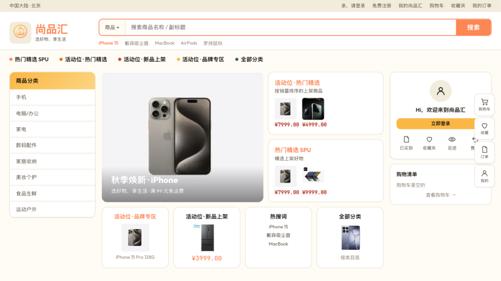
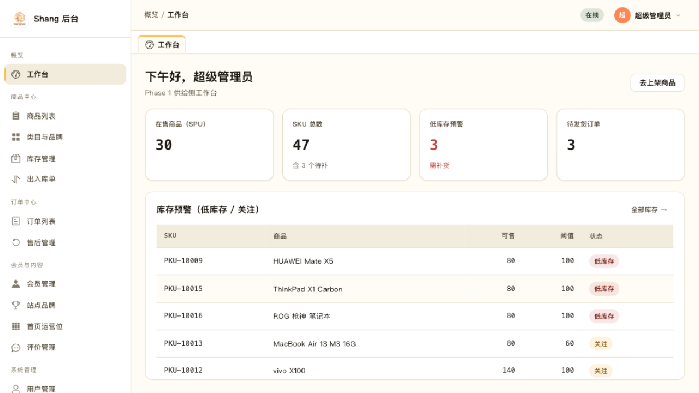

# 腾讯云部署实录（尚品汇）

> 部署日期：2026-11-01  
> 服务器：腾讯云轻量应用服务器 `lhins-0lfp6s8w`（Debian 13，北京，4C8G，60G）  
> 公网 IP：`49.233.135.247`

## 1. 访问地址

| 入口 | 地址 | 状态 |
|------|------|------|
| 商城 C 端 | http://49.233.135.247:60084/ | 200 |
| 管理端 | http://49.233.135.247:60085/ | 200 |
| 商城 API（nginx 反代） | http://49.233.135.247:60084/api/home | 200 |
| 原 Moodle | http://49.233.135.247/（80） | 200，未改动 |





## 2. 服务器架构

```text
公网
├─ :80    Moodle（原有 Docker，未改动）
├─ :60084 尚品汇商城（Nginx → /opt/shang-pivot/current/mall）
│         └─ /api/ → 127.0.0.1:8086
└─ :60085 尚品汇管理端（Nginx → /opt/shang-pivot/current/admin）
          └─ /api/、/admin/ → 127.0.0.1:8086

127.0.0.1:8086  Spring Boot 后端（systemd: shang-pivot）
127.0.0.1:8087  actuator（health/prometheus，仅本机）
127.0.0.1:5432  PostgreSQL 17
127.0.0.1:6379  Redis 8
127.0.0.1:5672  RabbitMQ
127.0.0.1:9000  MinIO（Docker: shang-minio，控制台 9001 仅本机）
```

关键路径：

| 项 | 值 |
|---|---|
| 发布根目录 | `/opt/shang-pivot` |
| 当前版本 | `/opt/shang-pivot/current -> releases/local-20261101-1354` |
| 服务名 | `shang-pivot` |
| Nginx 站点 | `/etc/nginx/sites-available/shang-pivot` |
| 环境变量 | `/etc/shang-pivot/shang-pivot.env`（600） |
| 应用日志 | `journalctl -u shang-pivot`、`/opt/shang-pivot/current/logs/` |

## 3. 本次部署做了什么

1. 安装 `openjdk-21-jre-headless`、`nginx`、`postgresql`、`redis-server`、`rabbitmq-server`。
2. 创建数据库用户/库 `shang`，随机密码写入服务器 env。
3. 创建 `shang-pivot` 系统用户、systemd 服务、`/opt/shang-pivot` 目录。
4. 构建后端 JAR（`-Djava.version=17`）与两个前端 `dist`。
5. 用 `scripts/deploy-release.sh` 上传、切 release、重启、健康检查。
6. 配置 Nginx 60084/60085，反代 `/api/` 与 `/admin/`。
7. 在腾讯云轻量防火墙放行 TCP 60084/60085。
8. 启动 MinIO，创建 `shang-pivot` 桶，上传 `PRODUCT/seed/` 商品图片。
9. 轮换 MinIO 默认密码，更新应用 env 并重启。
10. 验证商城/管理端登录、商品列表、商品图片、Moodle 未受影响。

## 4. 验收结果

| 检查 | 结果 |
|---|---|
| 商城首页 | 200 |
| 管理端登录页 | 200 |
| 会员登录 `13800000002 / 123456` | `code=0`，返回 token |
| 管理员登录 `admin / Admin@123` | `code=0`，返回 token |
| 商品列表 | `total=30` |
| 商品图片 | 200，WebP 1838B |
| `/actuator/health` | `status=UP` |
| systemd | `shang-pivot/nginx/postgresql/redis-server/rabbitmq-server` 全部 active |
| Moodle 80 | 200，未被影响 |

## 5. 凭证保存方式

### 5.1 服务器 SSH（已持久化）

- 本地私钥：`~/.ssh/tencent_deploy`，权限 600；
- 服务器 `root` 的 `~/.ssh/authorized_keys` 已加入对应公钥；
- 本地 `~/.ssh/config` 已有别名：

```text
Host shangpivot-tencent
  HostName 49.233.135.247
  User root
  IdentityFile ~/.ssh/tencent_deploy
  IdentitiesOnly yes
```

之后直接用：

```bash
ssh shangpivot-tencent
```

不需要再输入密码或授权。

> 注意：这是 root 密钥，权限较大。生产建议创建 `deploy` 用户 + 受限 sudo，或至少给私钥加 passphrase 并放入 ssh-agent/Keychain。

### 5.2 服务器端密钥（不进仓库）

`/etc/shang-pivot/shang-pivot.env`（600）保存：

- `DB_PASSWORD`（随机）
- `JWT_SECRET`（随机）
- `MINIO_ACCESS_KEY` / `MINIO_SECRET_KEY`（随机）
- `SHANG_CORS_ALLOWED_ORIGINS`

查看需要 root：

```bash
ssh shangpivot-tencent 'sudo grep -E "DB_PASSWORD|JWT_SECRET|MINIO_" /etc/shang-pivot/shang-pivot.env'
```

### 5.3 本地/CI 凭证建议

| 凭证 | 推荐保存位置 |
|---|---|
| 腾讯云 SSH 私钥 | `~/.ssh/tencent_deploy`（600）+ GitHub Secret `TENCENT_SSH_KEY` |
| known_hosts | GitHub Secret `TENCENT_KNOWN_HOSTS` |
| 飞书 Webhook | macOS Keychain + GitHub Secret `FEISHU_WEBHOOK` |
| GitHub PAT | macOS Keychain + 仅本地使用，不写仓库 |
| 数据库/MinIO 密码 | 只放服务器 env / 密码管理器，不复制到本地仓库 |

macOS Keychain 示例（把 `VALUE` 换成真实值）：

```bash
security add-generic-password -a "$USER" -s feishu-shangpivot -w "VALUE" -U
security find-generic-password -s feishu-shangpivot -w
```

> 不要把主账号密码、短信验证码、微信扫码会话保存到脚本或仓库。

## 6. 日常发布与回滚

一键构建 + 发布：

```bash
cd /Users/imac/Desktop/电商自动化测试/shang-pivot-master
bash scripts/deploy-tencent-local.sh
```

只回滚：

```bash
bash scripts/deploy-tencent-local.sh --rollback
```

脚本行为：

```text
构建 JAR/前端 → tar → scp → md5 校验 → 解包 releases/<revision>
→ 切 current → systemctl restart shang-pivot → 健康检查
→ 失败自动切回上一个 release
```

发布后检查：

```bash
curl -s -o /dev/null -w '%{http_code}\n' http://49.233.135.247:60084/
curl -s -o /dev/null -w '%{http_code}\n' http://49.233.135.247:60085/
ssh shangpivot-tencent 'curl -s http://127.0.0.1:8087/actuator/health'
```

## 7. 已知缺口（按优先级）

### P0

1. **没有 HTTPS/域名**：当前是 `http://IP:端口`，登录 token 明文传输。建议域名 + Let's Encrypt。
2. **SSH 使用 root**：建议 `deploy` 用户 + 受限 sudo，或至少密钥加 passphrase。
3. **防火墙 60084/60085 对 0.0.0.0/0 开放**：建议限制来源 IP，或只开 443 反代。

### P1

4. 没有数据库备份/恢复演练；建议每日 `pg_dump` + 异地保存。
5. 没有监控/告警接入（Prometheus/Grafana 未部署到这台机器）。
6. 单机 systemd 重启式部署，有秒级停机；后续可双实例/蓝绿。
7. MinIO 控制台仅本机，图片桶是公开下载；确认是否符合内容策略。
8. 与 Moodle 共用 4C8G，资源竞争需要监控；Moodle 在 80，未改动。

### P2

9. 没有 GitHub Actions 真实运行（Token 权限不足）。
10. 没有飞书真实通知（Webhook 未提供）。
11. 前端 admin bundle 868KB，建议 code split。
12. 商品图片是 WebP 但扩展名 `.jpg`，不影响显示，建议统一 MIME。

## 8. 凭证撤销

- 删除服务器公钥：

```bash
ssh shangpivot-tencent
sed -i '/shang-pivot-tencent-deploy/d' /root/.ssh/authorized_keys
```

- 删除本地私钥与别名：

```bash
rm -f ~/.ssh/tencent_deploy ~/.ssh/tencent_deploy.pub
# 删除 ~/.ssh/config 中 shangpivot-tencent 段
```

- 轮换数据库/MinIO/JWT：改 `/etc/shang-pivot/shang-pivot.env` 后 `systemctl restart shang-pivot`；MinIO 还需重建容器。
