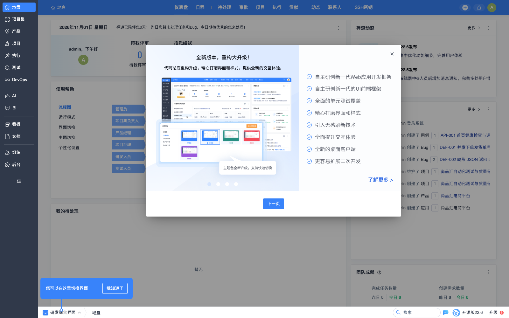
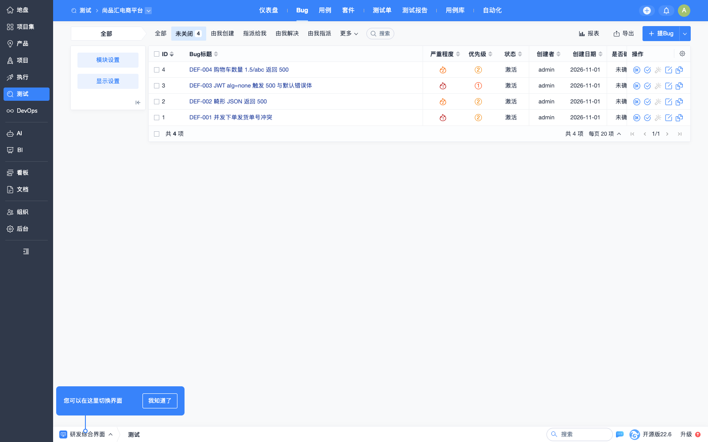
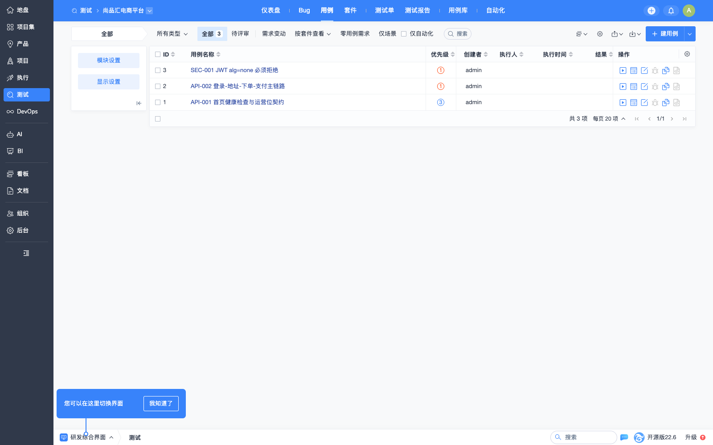
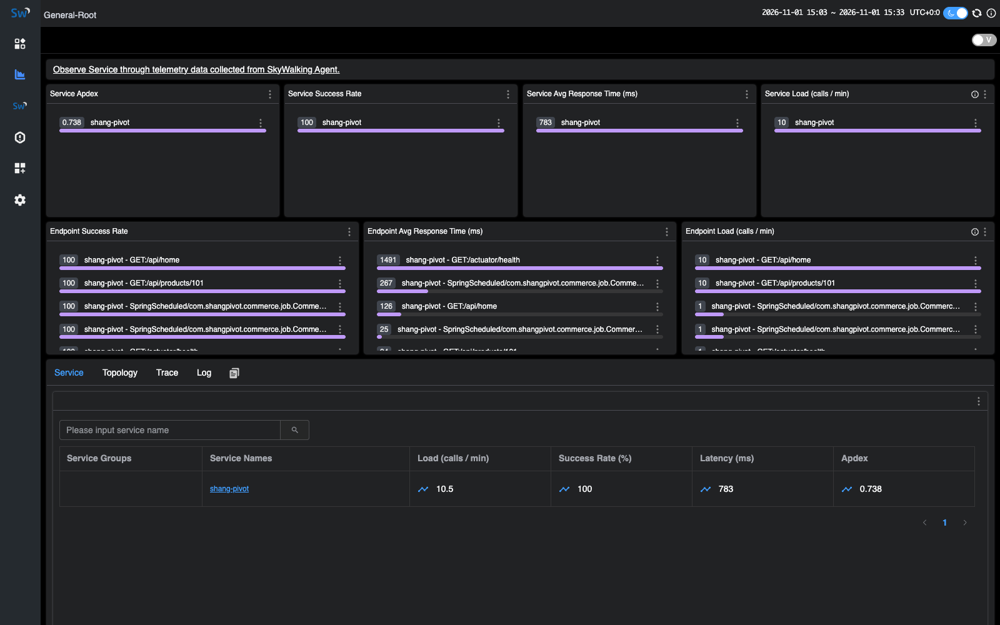
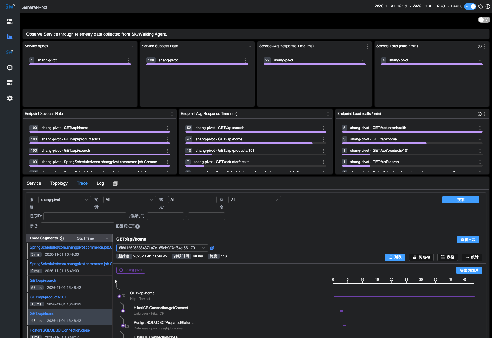

# 禅道 + SkyWalking 全链路监控部署实录

> 服务器：腾讯云轻量应用服务器 `lhins-0lfp6s8w`（Debian 13，4C8G，60G）  
> 公网 IP：`49.233.135.247`  
> 部署日期：2026-11-01  
> 关联项目：`shang-pivot` 尚品汇电商

## 1. 访问入口

| 系统 | 地址 | 说明 |
|---|---|---|
| 尚品汇商城 | http://49.233.135.247:60084/ | 原有入口，未改动 |
| 尚品汇管理端 | http://49.233.135.247:60085/ | 原有入口，未改动 |
| 禅道 22.6 | http://49.233.135.247:60084/zentao/ | 路径反代到 60082 |
| SkyWalking UI 10.2 | http://49.233.135.247:60084/skywalking/ | 路径反代到 60086，HTTP Basic Auth |

> 60082 / 60086 未在腾讯云防火墙放行。公网统一从已放行的 60084 进入，由 Nginx 按路径分流，避免再开端口。

### 1.1 凭证位置（不写入仓库）

| 凭证 | 服务器位置 | 读取方式 |
|---|---|---|
| 禅道管理员 `admin` 密码 | `/opt/zentao/admin-password`（600） | `ssh shangpivot-tencent 'cat /opt/zentao/admin-password'` |
| SkyWalking Basic Auth `ops` 密码 | `/opt/skywalking/ui-password`（600） | `ssh shangpivot-tencent 'cat /opt/skywalking/ui-password'` |
| SkyWalking 数据库密码 | `/opt/skywalking/oap.env`（600） | 仅 root 可读 |
| 电商数据库/JWT/MinIO | `/etc/shang-pivot/shang-pivot.env`（600） | 仅 root 可读 |

不要把上述密码复制到 Git、CI 日志或聊天记录。

## 2. 架构

```text
公网 :60084
└─ Nginx (default_server)
   ├─ /                 → /opt/shang-pivot/current/mall（商城 SPA）
   ├─ /api/             → 127.0.0.1:8086（Spring Boot）
   ├─ /zentao/          → 127.0.0.1:60082（禅道 Apache + 内置 MariaDB）
   │  ├─ /js/ /theme/ /data/ /api.php → 60082 静态/接口
   │  └─ /index.php     → 307 /zentao/index.php（修正禅道根路径表单）
   └─ /skywalking/      → 127.0.0.1:60086（SkyWalking UI）
      ├─ /static/       → /opt/skywalking/ui-static/static（已修补路由 base）
      └─ /graphql       → 127.0.0.1:12800/graphql（OAP）

公网 :60085 → 管理端 SPA / /api

本机回环：
127.0.0.1:11800  SkyWalking OAP gRPC（Agent 上报）
127.0.0.1:12800  SkyWalking OAP HTTP/GraphQL
127.0.0.1:9411   OAP Zipkin Receiver（可选）
127.0.0.1:60082  禅道
127.0.0.1:60086  SkyWalking UI
127.0.0.1:5432   PostgreSQL 17（电商库 + skywalking 库）
```

### 2.1 全链路数据流

```text
浏览器 / 自动化脚本
  → Nginx :60084 /api/
  → Spring Boot :8086
  → SkyWalking Java Agent 9.5.0（-javaagent）
  → OAP :11800
  → PostgreSQL skywalking 库
  → SkyWalking UI :60086 /graphql
```

Agent 自动采集：

- HTTP 入口：`Tomcat` Entry Span，端点如 `GET:/api/home`、`POST:/api/auth/login`；
- SQL：`postgresql-jdbc-driver` Exit Span，带 `db.statement`；
- 连接池：`HikariCP` Local Span；
- 缓存：`Lettuce` / Redis；
- 定时任务：`SpringScheduled/...`；
- JVM、服务、实例、端点指标。

## 3. 资源与容量

部署后实测：

| 组件 | 内存 | 说明 |
|---|---:|---|
| SkyWalking OAP | ~1.0 GiB | `JAVA_OPTS=-Xms512m -Xmx512m`，含 JVM 堆外/元空间 |
| SkyWalking UI | ~289 MiB | `-Xms256M` |
| 禅道（含 MariaDB） | ~341 MiB | 内置 MySQL/MariaDB + Apache + PHP |
| 商城 + Moodle + MinIO | 原有负载 | 未改动 |
| 系统可用内存 | ~3.6 GiB | `free -h` |
| Swap | 2 GiB | 已创建 `/swapfile` |
| 磁盘 | 59G，已用 13G（21%） | SkyWalking 库约 28 MB |

结论：4C8G 单机可以同时跑电商、Moodle、禅道、SkyWalking，但 OAP 是内存大户。若流量上来，优先把 OAP/PostgreSQL 拆到独立机器，或改用 BanyanDB/ES 集群。

## 4. 关键实现与踩坑

### 4.1 SkyWalking OAP 存储：`postgresql` 不是 `jdbc`

OAP 10.2 默认 `storage.selector` 是 `banyandb`。镜像里虽然带 `storage-jdbc-hikaricp-plugin`，但 provider 名称是：

- `mysql`
- `postgresql`

不是 `jdbc`。错误写法会导致：

```text
ProviderNotFoundException: no provider found for module storage
```

正确配置 `/opt/skywalking/oap.env`（600）：

```ini
SW_STORAGE=postgresql
SW_JDBC_URL=jdbc:postgresql://host.docker.internal:5432/skywalking
SW_DATA_SOURCE_USER=skywalking
SW_DATA_SOURCE_PASSWORD=<随机密码>
JAVA_OPTS=-Xms512m -Xmx512m
```

注意环境变量是 `SW_DATA_SOURCE_USER` / `SW_DATA_SOURCE_PASSWORD`，不是 `SW_JDBC_USER` / `SW_JDBC_PASSWORD`。

同时 PostgreSQL 默认只监听 `localhost`，容器通过 `host.docker.internal` 连不进来。已做：

```sql
ALTER SYSTEM SET listen_addresses = 'localhost,172.17.0.1';
```

`pg_hba.conf` 增加：

```text
host all all 172.17.0.0/16 scram-sha-256
```

然后重启 PostgreSQL。OAP 容器加：

```bash
--add-host=host.docker.internal:host-gateway
```

### 4.2 SkyWalking UI 必须能解析 OAP

OAP 和 UI 都重建后，默认 bridge 网络没有容器名 DNS，UI 报：

```text
UnknownHostException: Failed to resolve 'skywalking-oap'
```

解决：创建用户自定义网络并接入两个容器：

```bash
docker network create skywalking-net
docker network connect skywalking-net skywalking-oap
docker network connect skywalking-net skywalking-ui
```

OAP 还需启用健康检查，否则 UI 认为 OAP 不健康：

```ini
SW_HEALTH_CHECKER=default
```

验证：

```bash
curl -s -o /dev/null -w '%{http_code}\n' http://127.0.0.1:12800/healthcheck
# 200
```

### 4.3 Java Agent：9.5.0 可用，9.3.0 对 Spring 7 不够

项目是 Spring Boot 4.1.1 / Spring Framework 7.0.9。SkyWalking Java Agent 9.3.0 的 Spring MVC 插件只到 5.x，启动日志大量：

```text
enhance class ... is not activated. Witness class ... does not exist.
```

升级到 `apache/skywalking-java-agent:9.5.0-java17` 后，虽然仍有部分插件告警，但 HTTP/SQL 链路已经正常生成。

systemd drop-in：`/etc/systemd/system/shang-pivot.service.d/skywalking.conf`

```ini
[Service]
Environment="SW_AGENT_NAME=shang-pivot"
Environment="SW_AGENT_INSTANCE_NAME=shang-pivot-prod"
Environment="SW_AGENT_COLLECTOR_BACKEND_SERVICES=127.0.0.1:11800"
Environment="SW_LOGGING_OUTPUT=CONSOLE"
Environment="SW_LOGGING_LEVEL=INFO"
ExecStart=
ExecStart=/usr/bin/java -javaagent:/opt/skywalking/agent-95/skywalking-agent.jar -jar /opt/shang-pivot/current/app.jar
```

重启：

```bash
systemctl daemon-reload
systemctl restart shang-pivot
```

验证：

```bash
curl -s http://127.0.0.1:8087/actuator/health
# {"status":"UP"}

python3 /opt/skywalking/skywalking-query.py \
  --service shang-pivot --minutes 10 --endpoint /api/home
```

### 4.4 腾讯云 EdgeOne 会拦截未知域名

尝试用 `nip.io` / `sslip.io` 做“域名 + Host 路由”时，浏览器被腾讯云 EdgeOne 拦截：

```text
566 AccessDeny
您的请求已被该站点的安全策略拦截。
```

所以最终没有用子域名，而是：

- 只使用已放行的 `60084`；
- Nginx 按 `/zentao/`、`/skywalking/` 路径反代；
- 60082/60086 保持不对公网开放。

### 4.5 SkyWalking UI 子路径：需要修补前端路由 base

SkyWalking UI 是 Vite SPA，前端路由硬编码 `createWebHistory("/")`。直接挂在 `/skywalking/` 会显示：

```text
404 Page Not Found
```

处理方式：

1. 把 UI 静态资源抓到宿主机并打补丁：

```bash
python3 /opt/skywalking/fetch-skywalking-ui-static.py \
  --ui-url http://127.0.0.1:60086 \
  --out /opt/skywalking/ui-static \
  --base /skywalking/ \
  --clean
```

脚本会把 `index-CElEPs2H.js` 中的：

```js
history:X$("/")
```

替换为：

```js
history:X$("/skywalking/")
```

2. Nginx 用 alias 提供修补后的静态文件：

```nginx
location /static/ {
    auth_basic "SkyWalking";
    auth_basic_user_file /etc/nginx/.htpasswd-ops;
    alias /opt/skywalking/ui-static/static/;
    expires 1h;
}
```

3. `/skywalking/` 反代到 UI 根路径：

```nginx
location /skywalking/ {
    auth_basic "SkyWalking";
    auth_basic_user_file /etc/nginx/.htpasswd-ops;
    proxy_pass http://127.0.0.1:60086/;
    ...
}
```

> 升级 SkyWalking UI 镜像后，需要重新抓取 `/static` 并重新打补丁；这是当前方案唯一比较“脆”的地方。

### 4.6 禅道：内置 MySQL 要显式开启

`easysoft/zentao` 镜像自带 zbox MariaDB，但默认 `MYSQL_INTERNAL=false`，且 Apache 一直：

```text
Apache: Waiting MySQL N seconds
```

正确启动方式：

```bash
docker run -d --name zentao --restart unless-stopped \
  -p 60082:80 \
  -e MYSQL_INTERNAL=true \
  -e REDIS_INTERNAL=false \
  -v /opt/zentao/data:/data \
  easysoft/zentao:latest
```

关键点：

- 持久化目录是 `/data`，不是 `/var/lib/mysql`；
- 不要挂 `/app/zentaopms`，应用在 `/apps/zentao`；
- `MYSQL_INTERNAL=true` 后 entrypoint 才会把 `/etc/s6/s6-available/mysql` 链到 `s6-enable`；
- 首次启动会自动建库、建 `admin`。

### 4.7 禅道子路径：`webRoot`、表单 action、默认语言

禅道挂到 `/zentao/` 需要：

1. `/data/zentao/config/my.php` 设置：

```php
$config->webRoot = '/zentao/';
$config->default->lang = 'zh-cn';
```

2. `default->lang` 必须非空。为空时访问用户模块会报：

```text
Unsupported operand types: null + array in /apps/zentao/module/user/config/dtable.php:45
```

3. 登录表单 action 仍然是 `/index.php`，用 Nginx 307 保留 POST 重定向：

```nginx
location = /index.php {
    return 307 /zentao/index.php$is_args$args;
}
```

4. 禅道页面还会请求根路径 `/js/`、`/theme/`、`/data/`、`/api.php`，在 60084 上补代理即可。

## 5. 禅道与尚品汇的结合

已在禅道创建：

| 数据 | 内容 |
|---|---|
| 产品 | 尚品汇电商平台（ID 1） |
| 项目 | 尚品汇自动化测试与质量保障（ID 1） |
| 执行 | Sprint 1 - 自动化回归 |
| Bug | 4 条，来自自动化测试已知缺陷 |
| 用例 | 3 条，覆盖首页契约、购买主链路、JWT 安全 |

Bug 列表：

1. `DEF-001 并发下单发货单号冲突`
2. `DEF-002 畸形 JSON 返回 500`
3. `DEF-003 JWT alg=none 触发 500 与默认错误体`
4. `DEF-004 购物车数量 1.5/abc 返回 500`

用例列表：

1. `API-001 首页健康检查与运营位契约`
2. `API-002 登录-地址-下单-支付主链路`
3. `SEC-001 JWT alg=none 必须拒绝`







禅道 API 可直接用于后续 CI 同步：

```bash
TOKEN=$(curl -s -X POST http://127.0.0.1:60082/api.php/v1/tokens \
  -H 'Content-Type: application/json' \
  -d '{"account":"admin","password":"<从服务器读取>"}' | jq -r .token)

curl -s -H "Token: $TOKEN" \
  http://127.0.0.1:60082/api.php/v1/products/1/bugs
```

## 6. SkyWalking 验证结果

### 6.1 服务与端点

SkyWalking UI / GraphQL 已能看到：

- Service：`shang-pivot`
- 端点：`GET:/api/home`、`GET:/api/products/101`、`GET:/api/search`、`POST:/api/auth/login`、`GET:/actuator/health`
- 定时任务：`SpringScheduled/...CommerceJobs...`
- 下游：`127.0.0.1:5432`（PostgreSQL）、`127.0.0.1:6379`（Redis）



### 6.2 HTTP → SQL 链路

用 `/opt/skywalking/skywalking-query.py` 实测一条 `GET:/api/home`：

```text
trace=6f80125963884371a7e165db927af64e.57.17935183823090005 spans=116
    0 parent= -1 Entry Tomcat                     GET:/api/home
    1 parent=  0 Local HikariCP                   HikariCP/Connection/getConnection
    2 parent=  0 Exit  postgresql-jdbc-driver     PostgreSQL/JDBC/PreparedStatement/executeWithFlags
       SQL: SELECT id,logo_key,name,slogan,... FROM commerce.site_brand WHERE id=?
    ...
       SQL: SELECT id,code,title,status,sort,... FROM commerce.home_slot WHERE status=? ORDER BY sort ASC
       SQL: SELECT ... FROM commerce.home_slot_item WHERE slot_id=? AND status=? ORDER BY sort ASC
       SQL: SELECT ... FROM commerce.spu WHERE id IN (?,?,?,?) ...
       SQL: SELECT ... FROM commerce.sku WHERE deleted=false AND (spu_id IN (?,?,?))
       SQL: SELECT COUNT(*) AS total FROM commerce.spu WHERE deleted=false AND status=?
```

这说明可以从“哪个接口慢”直接下钻到“哪条 SQL 慢”。



> `/api/home` 一次请求产生 100+ span，主要是首页聚合的多次单表查询；这也是一个性能优化点：可合并查询或做缓存。

### 6.3 告警与慢 SQL

本次新增：

- `/opt/skywalking/alarm-settings.yml`，挂载到 OAP `/skywalking/config/alarm-settings.yml`；
- 8 条规则：服务响应时间/SLA/P95、实例响应时间、数据库访问、端点响应时间/SLA、JVM CPU；
- `skywalking-alarm-webhook` systemd 服务，监听 `172.17.0.1:18080`；
- 告警 JSONL：`/var/log/skywalking-alarm/alarms.jsonl`；
- OAP 显式配置 `SW_SLOW_DB_THRESHOLD=default:200`。

已验证：

```bash
curl -s http://172.17.0.1:18080/health
# {"status":"UP"}

curl -s -X POST http://172.17.0.1:18080/alarm \
  -H 'Content-Type: application/json' \
  -d '{"scope":"SERVICE","name":"shang-pivot","alarmMessage":"manual test"}'
# {"status":"accepted"}

docker exec skywalking-oap curl -s http://host.docker.internal:18080/health
# {"status":"UP"}
```

正式告警规则已加载；业务阈值尚未触发过真实告警，故障演练时用 `alarm-settings.test.yml` 或压测验证完整链路。

详细规则、Runbook、故障处理见 [SkyWalking 运维手册](SkyWalking运维手册.md)，课堂讲义见 [03-SkyWalking全链路监控课件.md](../courseware/03-SkyWalking全链路监控课件.md)。

## 7. 常用运维命令

```bash
# 容器
docker ps
docker stats --no-stream
docker logs --tail 100 skywalking-oap
docker logs --tail 100 skywalking-ui
docker logs --tail 100 zentao

# 服务
systemctl status shang-pivot nginx postgresql redis-server rabbitmq-server
journalctl -u shang-pivot -n 200 --no-pager

# 健康检查
curl -s http://127.0.0.1:8087/actuator/health
curl -s -o /dev/null -w '%{http_code}\n' http://127.0.0.1:12800/healthcheck
curl -s -o /dev/null -w '%{http_code}\n' http://127.0.0.1:60084/
curl -s -o /dev/null -w '%{http_code}\n' http://127.0.0.1:60084/zentao/

# SkyWalking 链路
python3 /opt/skywalking/skywalking-query.py --service shang-pivot --minutes 30
```

重启顺序建议：

```bash
systemctl restart postgresql
docker restart skywalking-oap
sleep 20
docker restart skywalking-ui
systemctl restart shang-pivot
```

## 8. 安全与后续

已做：

- 禅道 `install.php` 已改名为 `install.php.disabled`，防止重复安装；
- 禅道管理员密码已轮换为随机值，存服务器 600 文件；
- SkyWalking UI 加 HTTP Basic Auth（`ops`），密码存服务器 600 文件；
- OAP 11800/12800/9411 只绑定 `127.0.0.1`；
- 60082/60086 不对公网开放；
- 2G swap，降低 OOM 风险。

仍需注意：

1. **没有 HTTPS**：Basic Auth 和禅道登录密码在 HTTP 下明文传输。生产必须上域名 + TLS。
2. **Basic Auth 不是强认证**：建议接 OIDC / 公司 SSO，或至少限制来源 IP。
3. **OAP 单节点**：没有 HA；PostgreSQL 也没有备份演练。
4. **没有告警**：SkyWalking Alarm 规则未配置；可接飞书 Webhook。
5. **UI 静态补丁**：升级 UI 镜像后要重做，建议后续改成构建时注入 `base`。
6. **CI 未打通禅道**：当前是手工/API 建单；下一步可在 `e2e.yml` 失败后自动创建 Bug。

## 9. 交付清单

| 项 | 状态 |
|---|---|
| 禅道 22.6 部署并可登录 | ✅ |
| 禅道产品/项目/Bug/用例 | ✅ |
| SkyWalking OAP + UI | ✅ |
| PostgreSQL 存储 | ✅ |
| 电商应用 Java Agent 接入 | ✅ |
| HTTP + SQL 链路可查 | ✅ |
| 公网路径访问 | ✅ |
| Basic Auth / 管理密码轮换 | ✅ |
| HTTPS / 告警 / CI 自动建单 | ⏳ 后续 |
