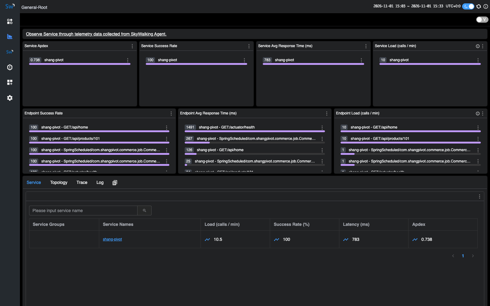
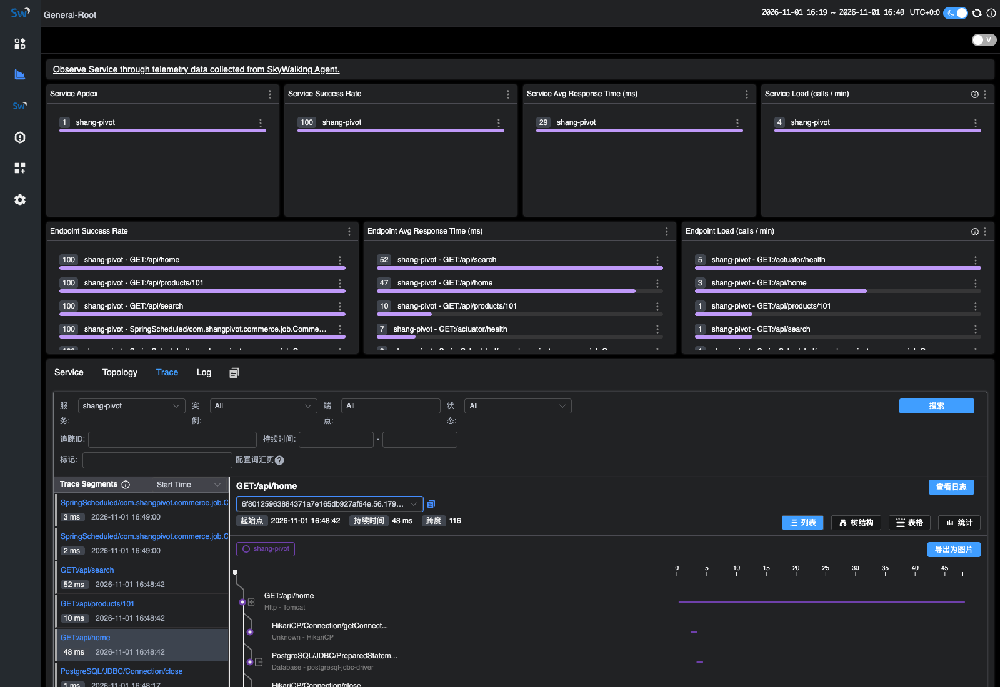

# 从 0 搭一套 SkyWalking：我踩了 5 个坑，扒出 116 个 Span 和 39 条 SQL

大家好，我是段文瑞。

最近给尚品汇电商搭了一套 SkyWalking。第一次排障，一个 `/api/home` 请求：客户端耗时 **77.6ms**，服务端 Trace **48ms**，一次请求 **116 个 Span、39 条 SQL**。

这篇不讲概念堆砌，讲三件事：

- 我怎么从 0 搭起来；
- 踩了哪 5 个坑；
- 怎么从“接口慢”一步步下钻到 SQL。

> 说明：本文基于真实测试环境，IP、账号、密码已脱敏。

## 01 先看一张全景图



链路很短：

```text
Spring Boot 应用
  → SkyWalking Java Agent 9.5.0
  → OAP 10.2.0（gRPC 11800）
  → PostgreSQL 17（skywalking 库）
  → SkyWalking UI 10.2.0（Nginx /skywalking/）
```

一台 4C8G 的腾讯云轻量服务器，上面还跑着商城、管理端、Moodle 和禅道。

监控不是“再装一个软件”，而是给排查加一条路径：**服务 → 实例 → 端点 → Trace → Span → SQL**。

## 02 为什么测试工程师要懂全链路监控

以前做接口测试，我们常看三样东西：

- HTTP 状态码是不是 200；
- 业务 `code` 是不是 0；
- 响应时间有没有超过阈值。

但真正上线后，问题往往不是“接口挂了”，而是：

- 接口成功率 100%，但 P95 从 80ms 涨到 800ms；
- 某个页面慢，但不知道慢在应用、数据库、Redis，还是 Nginx；
- 日志里只有一行异常，无法还原一次请求经过了哪些方法、哪些 SQL。

SkyWalking 解决的就是这个问题：把一次请求拆成 Trace、Span、Segment，让你从“接口慢”一路下钻到“哪条 SQL 慢”。

## 03 环境与版本

| 组件 | 版本 |
|---|---|
| SkyWalking OAP / UI | 10.2.0 |
| Java Agent | 9.5.0 |
| 应用 | Spring Boot 4.1.1 / Spring 7 |
| 存储 | PostgreSQL 17 |
| 服务器 | 4C8G，2G swap |

这里有一个关键点：**Agent 版本要跟框架版本匹配**。项目是 Spring Boot 4.1.1 / Spring 7，Java Agent 9.3.0 的 Spring MVC 插件只到 5.x，启动日志大量 `is not activated`；升级到 9.5.0 后，HTTP、JDBC、HikariCP、Redis 的 Span 才完整出现。

## 04 五个真实踩坑

### 坑 1：`SW_STORAGE=jdbc` 启动失败

OAP 10.2 默认存储是 `banyandb`，PostgreSQL 的 provider 名称是 `postgresql`，不是 `jdbc`。

错误写法会报：

```text
ProviderNotFoundException: no provider found for module storage
```

正确配置：

```ini
SW_STORAGE=postgresql
SW_JDBC_URL=jdbc:postgresql://host.docker.internal:5432/skywalking
SW_DATA_SOURCE_USER=skywalking
SW_DATA_SOURCE_PASSWORD=******
```

注意环境变量是 `SW_DATA_SOURCE_USER` / `SW_DATA_SOURCE_PASSWORD`，不是 `SW_JDBC_USER`。

**教训**：不要凭经验猜 provider 名称，先看官方配置和启动日志。

### 坑 2：容器连不上宿主机 PostgreSQL

PostgreSQL 默认只监听 `localhost`。容器通过 `host.docker.internal` 过来时会被拒绝。

处理：

```sql
ALTER SYSTEM SET listen_addresses = 'localhost,172.17.0.1';
```

`pg_hba.conf` 放行 Docker 网段：

```text
host all all 172.17.0.0/16 scram-sha-256
```

### 坑 3：UI 解析不到 OAP

OAP 和 UI 都重建后，默认 bridge 网络没有容器名 DNS，UI 报：

```text
UnknownHostException: Failed to resolve 'skywalking-oap'
```

解决：创建自定义网络，把两个容器接进去：

```bash
docker network create skywalking-net
docker network connect skywalking-net skywalking-oap
docker network connect skywalking-net skywalking-ui
```

### 坑 4：Agent 版本和 Spring 7 不匹配

Java Agent 9.3.0 的 Spring MVC 插件只到 5.x，启动日志大量：

```text
enhance class ... is not activated
```

升级到 `apache/skywalking-java-agent:9.5.0-java17` 后，HTTP、JDBC、HikariCP、Redis 的 Span 才完整出现。

### 坑 5：UI 挂到 `/skywalking/` 显示 404

SkyWalking UI 是 Vite SPA，路由 base 硬编码 `/`。直接挂子路径会显示 `404 Page Not Found`。

处理分三步：

1. 把 UI 静态资源抓到宿主机；
2. 把 `index-*.js` 里的 `history:X$("/")` 改成 `history:X$("/skywalking/")`；
3. Nginx 用 `alias` 提供修补后的 `/static/`。

> 这一步比较“脆”，升级 UI 镜像后要重做。完整脚本在仓库里。

## 05 一次真实请求：77.6ms 背后是 116 个 Span

从公网入口发起请求：

```bash
BASE=http://49.233.135.247:60084
curl -sS -m 10 -w '\nHTTP %{http_code} time=%{time_total}s\n' \
  "$BASE/api/home" -o /tmp/home.json
```

结果：

```text
HTTP 200 time=0.077574s
```

响应：

```json
{
  "code": 0,
  "msg": "success",
  "traceId": "899bc6269ffd468eab46ee506c56b6b1",
  "feed": 20,
  "slots": 6
}
```

等 10–15 秒，让 Agent 上报、OAP 聚合，然后在服务器上查：

```bash
python3 /opt/skywalking/skywalking-query.py \
  --service shang-pivot --minutes 5 --limit 100 --endpoint /api/home
```

结果：

```text
1793522922191   48ms   GET:/api/home
trace=6f80125963884371a7e165db927af64e.56.17935229221910007 spans=116
SQL spans: 39
```

对比：

| 指标 | 值 |
|---|---:|
| 客户端总耗时（含 Nginx/网络） | 77.6ms |
| 应用内 Trace 耗时 | 48ms |
| Span 总数 | 116 |
| SQL Span 数 | 39 |

**服务端 48ms，客户端 77.6ms，约 29.6ms 消耗在 Nginx、网络、响应传输/序列化上。**

只看客户端耗时会误判成“应用慢”，只看 Trace 会漏掉接入层成本。



Span 树大致是：

```text
Entry  Tomcat GET:/api/home
Local  HikariCP/Connection/getConnection
Exit   PostgreSQL/JDBC/.../executeWithFlags
       SELECT ... FROM commerce.site_brand WHERE id=?
Local  HikariCP/Connection/close
...
```

39 条 SQL 主要来自：

- `commerce.site_brand`：品牌信息；
- `commerce.home_slot`：首页运营位；
- `commerce.home_slot_item`：运营位商品，多次重复；
- `commerce.spu` / `commerce.sku`：商品与 SKU，单条 + 批量混合；
- `identity.system_config`：系统配置；
- `COUNT(*)`：商品总数。

典型 SQL：

```sql
SELECT id,logo_key,name,slogan,favicon_key,updated_at,updated_by,trace_id
FROM commerce.site_brand WHERE id=?

SELECT id,slot_id,sort,spu_id,image_key,link_type,link_value,title,extra,status
FROM commerce.home_slot_item
WHERE (slot_id = ? AND status = ?) ORDER BY sort ASC

SELECT id,spu_id,title,price,cost_price,bar_code,specs,pic,status,created_at,updated_at,deleted,trace_id
FROM commerce.sku
WHERE deleted=false AND (spu_id = ? AND status = ?)
```

结论：

- 没有报错，也没有超过 200ms 的慢 SQL；
- 但 `home_slot_item`、`sku` 存在重复查询和 N+1 风险；
- 20 个 feed 商品会放大 SQL 数量，feed 增加到 100 时 Span 会继续上涨。

优化方向：

1. 首页品牌/运营位/系统配置加缓存；
2. 按 `spu_id` 批量查 SKU；
3. 限制首页 feed 数量；
4. 补 `home_slot_item(slot_id,status)`、`sku(spu_id,status)` 索引；
5. 用 P95 和 SQL Span 数做验收指标。

## 06 我是怎么一步步排查的

不要一上来就看 Trace。我的顺序是：

### 1. 看服务 RED

SkyWalking → General-Service → Services → `shang-pivot`：

- Apdex；
- Success Rate；
- Avg Response Time；
- Load。

先判断是全局问题，还是某个接口、某个实例。

### 2. 看实例和 JVM

如果只有单个实例慢，先看：

- JVM CPU；
- Heap；
- Thread；
- Old GC。

当前实测：CPU 1%，Heap 约 212MB，Thread 67，Old GC 0。

### 3. 看端点 TopN

优先选“耗时长 × 流量高”的端点，而不是只选最慢的端点。

`/api/home` 平均 48ms，但一次 116 个 Span，优化收益比一个低频的 1.5s 健康检查更大。

### 4. 看 Trace

按端点、耗时、错误过滤，点进 Trace：

- Entry：总耗时、HTTP 状态；
- HikariCP/getConnection：是否在等连接；
- JDBC execute：SQL 本身耗时；
- Lettuce：Redis 是否慢；
- Span 数量：是否 N+1。

### 5. 看 SQL 和日志

- `db.statement`；
- `peer`；
- `component`；
- 是否超过 `SW_SLOW_DB_THRESHOLD`（当前 200ms）。

最后用应用日志确认异常和业务错误码。

## 07 告警和慢 SQL

只监控不告警，等于没有监控。

这次配了 8 条规则：

- 服务响应时间 > 1000ms；
- 服务 SLA < 95%；
- P95 > 1000ms；
- 实例响应时间 > 1000ms；
- 数据库访问 > 200ms；
- 端点响应时间 > 1000ms；
- 端点 SLA < 95%；
- JVM CPU > 80%。

告警走本地 Webhook：

```text
OAP → host.docker.internal:18080/alarm
    → /var/log/skywalking-alarm/alarms.jsonl
```

慢 SQL 阈值：

```ini
SW_SLOW_DB_THRESHOLD=default:200
```

SQL 参数默认不采集：

```ini
SW_JDBC_TRACE_SQL_PARAMETERS=false
```

打开后能看到 `?` 的实际参数，但可能泄露手机号、地址，生产慎用。

## 08 还缺什么

SkyWalking 是 APM，不是完整可观测性平台。

当前还缺：

| 层级 | 缺什么 | 建议 |
|---|---|---|
| 主机 | CPU、内存、磁盘、网络 | node_exporter + Prometheus/Grafana |
| PostgreSQL | 连接数、慢查询、锁 | postgres_exporter |
| Redis | 命中率、内存、evict | redis_exporter |
| Nginx | 4xx/5xx、上游耗时 | nginx-prometheus-exporter |
| 日志 | TraceId 关联 | Logback + Loki/ELK |
| SLO | 错误预算 | Prometheus + SLO 看板 |
| 业务 | 下单/支付成功率 | Micrometer 自定义指标 |
| 告警路由 | 飞书/钉钉/值班 | Alertmanager/飞书机器人 |

P0 建议：

1. 上 HTTPS；
2. 告警接飞书/钉钉；
3. 日志输出 `traceId`。

P1 再补主机、数据库、Redis、Nginx 指标。

## 09 三个坚持

回看这次搭建和排障，我总结了三点：

1. **先看数据，再下结论**。客户端 77.6ms、服务端 48ms，差的 29.6ms 不在应用里，先别急着改 SQL。
2. **从全局到局部，逐层下钻**。服务 → 实例 → 端点 → Trace → Span → SQL，每一步都缩小范围。
3. **监控必须闭环到告警**。只有仪表盘没有告警，问题仍然要等用户来告诉你。

## 10 最后

这次最大的收获不是“装好了 SkyWalking”，而是：

> 看到接口慢，先别急着改 SQL。  
> 先对比客户端耗时和服务端 Trace，再决定查应用、查接入层，还是查网络。

如果这篇对你有帮助，欢迎点个 **赞/在看**，转发给正在排障的同事。

完整部署手册、课件和脚本：

- GitHub：https://github.com/billhunthouse/shang-pivot-automation
- Gitee：https://gitee.com/simon6wu/shang-pivot-automation
